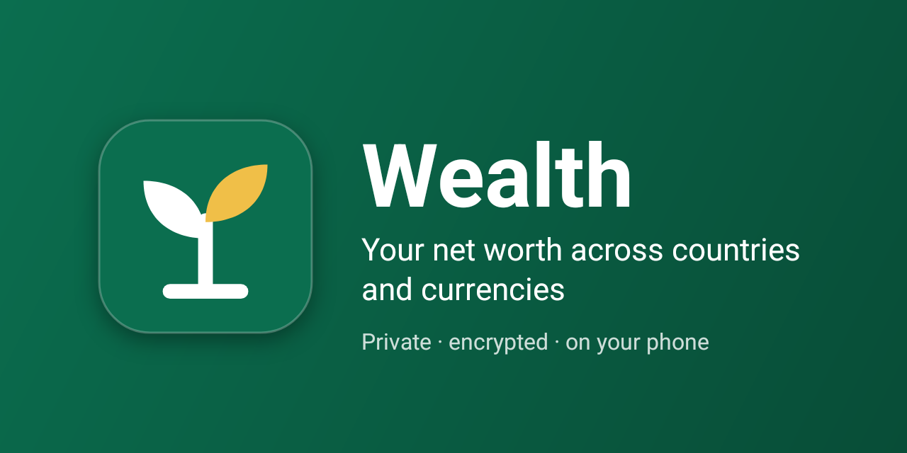
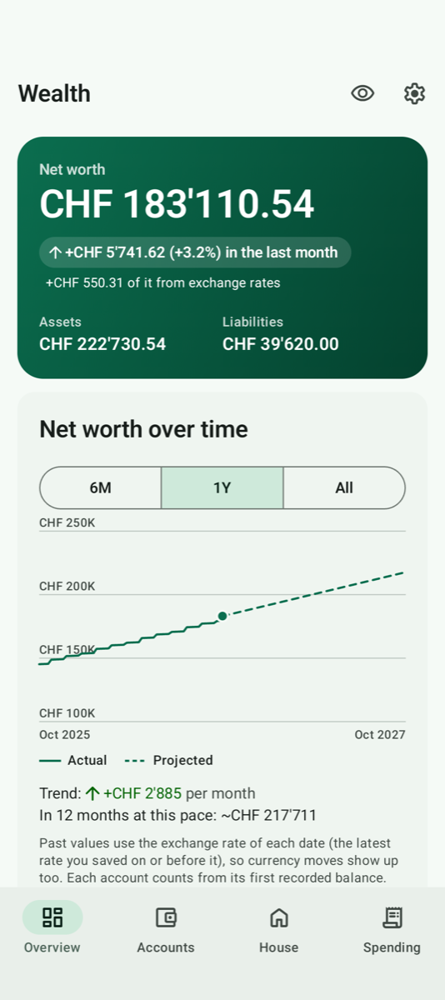
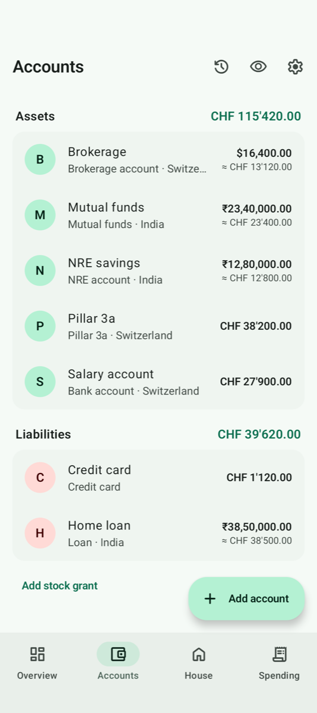
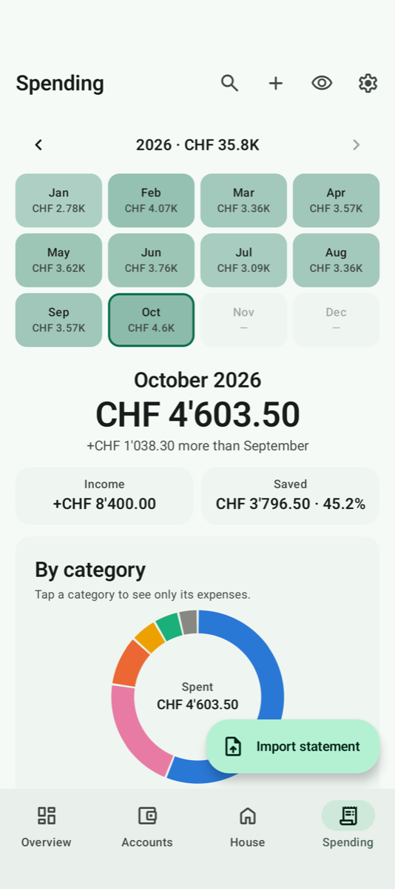
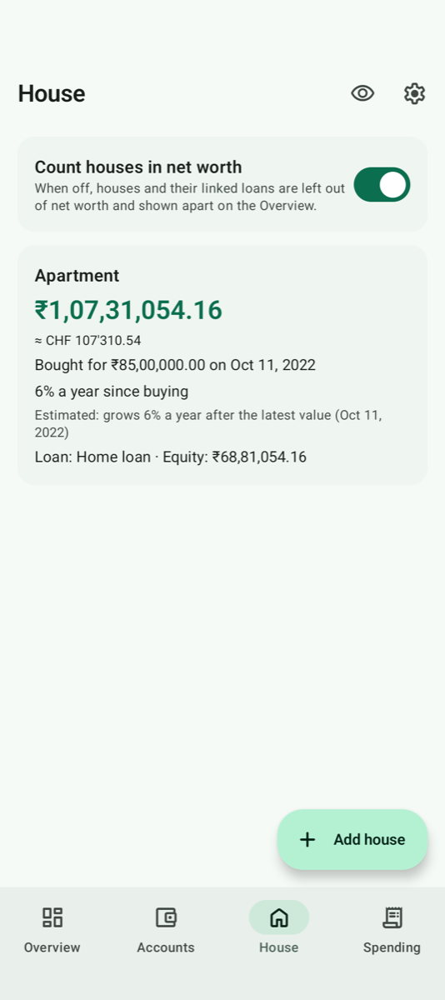
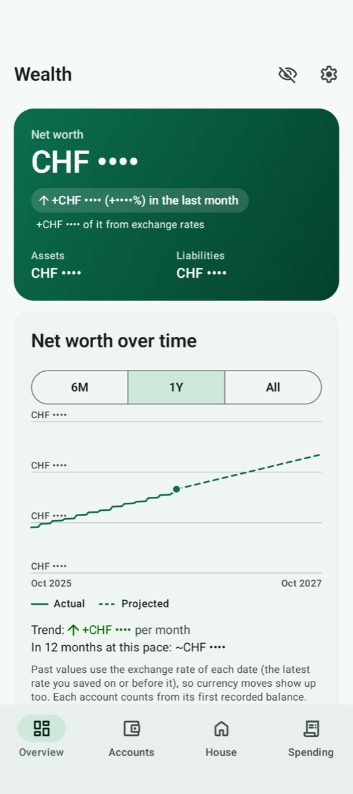
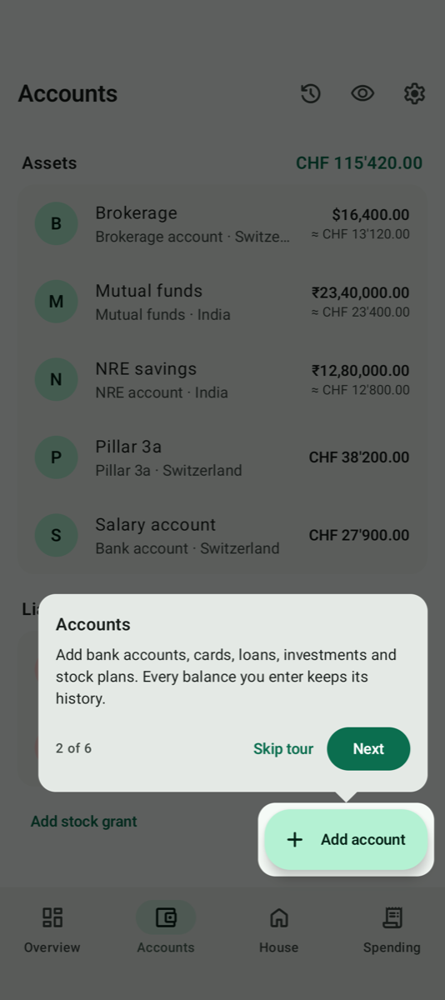

<p align="center">
  
</p>

# Wealth

A private Android app for your **net worth** and **spending** across countries
and currencies.

Built for people whose money lives in more than one place. For example,
someone from India working in Switzerland, with a salary and pension in CHF,
savings and funds in INR, and company stock in USD. Everything is
configurable, so any other mix of countries and currencies works just as
well.

**[Download the latest APK](../../releases/latest)** · Android 12 or newer

## Screenshots

<p align="center">
  
  
  
  
</p>
<p align="center">
  
  
</p>

<sub>Screenshots use made-up sample data.</sub>

## What's new

- **Asset classes:** the Overview's "Where your money is" can also group by
  asset class (cash & deposits, stocks & funds, pension, property, gold,
  other) or show each account on its own. Each account type has a class
  (Settings › Account types); the built-in ones come set.
- **Regular payments:** a card on the Spending tab lists payments that
  repeat with exactly the same amount at the same shop, every month (3
  times or more) or every year (twice or more), with what each costs in a
  year and when it's next due. Ones that stopped are listed apart; "Not a
  regular payment" hides a wrong find. Tap one to see its transactions.
- **Search by category, account and shop:** Search has Category and
  Account filters and a chart of the last 12 months of what it finds; tap
  a month to see only its transactions. On the Spending tab, a filtered
  category offers "… in every month", and a transaction offers "More from
  COOP" to see that shop's other transactions.
- **Automatic backups:** Settings › Backup › Automatic backup keeps one
  encrypted backup file (e.g. on Google Drive) up to date: once a day,
  whenever something changed. You choose the password once; the phone
  keeps it locked with its secure hardware. If the file can't be written
  any more, a notification (no amounts) and Settings say so.
- **Safer fingerprint unlock:** fingerprint (or strong face) unlock now
  needs a key from the phone's secure hardware, so it can't be faked by
  tampering with the app. After fingerprints change on the phone, the PIN
  is needed once.
- **Home-screen widget:** net worth at a glance; make it wider for this
  month's change and spending. While the eye is closed, or whenever an app
  lock is set, it shows "••••" instead; tapping it opens the app.
- **What exchange rates did:** with accounts in more than one currency, the
  Overview's monthly change and each monthly review say how much of it came
  from exchange rates (e.g. a weaker rupee), per currency; the rest is your
  saving, spending and growth.
- **Monthly review:** how last month went on one screen: net worth at the
  start and end and which accounts moved it, income, spending and what you
  saved against the month before, the biggest categories, and accounts with
  no balance that month. In the first week of a month a notification (no
  amounts in it) and an Overview card point to it; "Monthly reviews" on the
  Overview goes back to any month.
- **Open statements from other apps:** in Gmail, Files or Downloads, open
  or share a statement (PDF, CSV or Excel) with Wealth. One file goes
  straight to Import; several shared at once go to "Build history from
  statements".
- **Password-protected statements:** a locked PDF (as Indian banks often
  send them) asks for its password and then imports as usual. In "Build
  history from statements" one password is tried on all locked files. The
  password is only used to open the file, never saved.
- **Reminders to update balances:** when an account's latest balance is
  older than 35 days (or 14, 60, 90: Settings › Reminders), the Overview
  lists it, and a weekly notification says how many (never which accounts
  or amounts). Calculated loans, growing pensions and houses are left out.
- **Every group in the asset chart:** on the Overview, the smallest groups
  fold into "N more", which opens to show each one.
- **Export to a spreadsheet:** Settings › Backup can save every
  transaction, or your whole balance history, as a CSV file for Excel,
  Google Sheets or your taxes (money out negative; split bills one row
  per part). Unlike a backup, the file isn't encrypted.
- **Search every transaction:** the search button on the Spending tab
  looks through all months at once, by words from the statement line, a
  note, the category or the account, or by an amount ("45.30", or "45" for
  anything from 45.00 to 45.99). It shows how many match and their total
  per currency; tap one to open it.
- **Categories and patterns in one place:** Settings lists your
  categories; each opens into its patterns (the words that sort statement
  lines into it), to add, edit, move or delete. Changes re-sort your saved
  transactions straight away (never ones you categorized yourself). A box
  tests which category a statement line would get.
- **Update notice:** once a day the app checks GitHub for a newer version
  and offers to download and install it (checked against its checksum;
  Android asks you to confirm). Settings › Updates can turn it off or check
  now.
- **Restore after reinstalling:** uninstalling deletes the app's data, but
  not your backup file. On a fresh install, the welcome screen offers
  "Restore from a backup" and goes straight into the app with everything
  back. A restored older backup also gets newer defaults at once.
- **Categories follow Spent / Received:** an expense's category list shows
  spending categories for money out, and income categories (then spending
  ones, for refunds) for money in; the same on the Import screen.
- **Pensions that grow between statements:** for pillar 2 (and EPF/PPF),
  enter each yearly certificate's value; with the yearly contributions and
  interest rate, the account grows month by month after the latest one, and
  in a straight line between two. Values you enter always win.
- **Split a transaction:** one bill in several categories (e.g. a
  supermarket receipt with groceries and household items). Open the
  expense, "Split into parts", give each part an amount and category; the
  rest stays in the expense's own category, so the parts always add up.
  Each part is listed and counted on its own; the bank row stays one row.
- **Nothing is left out of an import silently:** every statement row comes
  in, and rules only pick the category (a category's own switch decides
  whether it counts as spending). Backfill shows what it didn't add and
  why (already imported, deleted before, same day and amount already
  saved), with "Add anyway" for the last; statements that don't add up are
  listed to check. Picked statements are listed newest first.
- **HDFC credit cards:** card statements (the 2021–2024 layout and the
  current one, domestic and international rows) import and backfill,
  checked against the statement's summary.
- **Older HDFC statements:** the net-banking PDFs (2021–2024 layout) read
  too, checked against their running balance and totals, so you can build
  history further back.
- **Every category in the spending chart:** the smallest categories fold
  into "N more categories", which opens to show each one; tap any of them
  to see only its expenses.
- **EMIs count only their interest:** link a calculated loan to the
  category its EMIs are imported into (e.g. "Home loan"). Each EMI stays
  one transaction, but Spending counts only that month's interest; the
  rest shows as principal repaid, not counted.
- **Loans that update themselves:** switch on "Calculate the balance" for a
  loan or mortgage and enter the amount, EMI and interest rate (and any
  rate changes, which you can edit later). The outstanding is worked out
  month by month; a balance
  from a statement, or a prepayment, always wins.
- **Add from each section:** on the Accounts tab, the + next to Assets,
  Liabilities and Stock grants adds that kind of thing, and the form only
  offers matching types.
- **Tidier balance history:** account filters wrap onto more lines instead
  of scrolling sideways, and long values (like shares plus cash) wrap in
  their half of the row.

## Features

**Net worth, in one number**
- Every account keeps its own currency; totals show in the base currency you
  choose.
- **Exchange rates are downloaded daily** (European Central Bank, with a
  fallback source) for past dates too, so history uses each day's rate. A
  rate you type yourself is never overwritten.
- **Each amount in its currency's own style,** e.g. `CHF 1’234.50`,
  `₹12,34,567.00`, `$1,234.50`, with short chart labels like `₹12.5L`.
- **History chart** (6 months, 1 year, all) with a 12-month trend and
  projection.
- **Breakdown** by account type, country, currency, asset class (cash, stocks, pension, property, gold, other) or account, and **what changed**
  since last month.
- **Leave out any account** from net worth; it stays listed with its
  history.

**Accounts and liabilities**
- Bank accounts, pensions (e.g. Pillar 2/3a, EPF, PPF), investments, mutual
  funds, gold, cash, loans, mortgages and credit cards.
- Types, countries and categories come as editable defaults you can
  rename, delete or extend.
- Every balance you enter builds a history you can view and correct.
- **Company stock (RSU/GSU):**
  - a share account is valued as shares × daily price
  - grants show what's still unvested and when the next shares vest.
- **Calculated loans:** a loan's outstanding follows its amount, EMI and
  interest rate (rate changes keep the EMI unless you change it); known
  balances and prepayments correct it.
- **House tab:** a home's value grows from its purchase price and your
  estimates at a yearly rate. A linked loan shows your equity, and one
  switch counts houses in net worth or not.

**Spending**
- Monthly totals with a category chart, a comparison with the month before,
  and a year view of all months, shaded by how much you spent. Tap a month,
  or swipe left and right to move between months.
- **Income and savings:** money in goes into income categories (salary,
  interest…), shown with the month's income and what you saved.
- **Import statements** (PDF or CSV). Patterns sort money out and in into
  categories, and duplicates are skipped: a transaction you deleted stays
  deleted, and one already saved from another file (same day and amount)
  is held back. Card bill payments are listed but
  not counted, since the card statement's purchases are.
- **Categories that aren't spending** (e.g. transfers to your broker) are
  switched off in Settings and listed apart from the totals. Categories
  keep the order you drag them into.

**Getting started**
- A short welcome screen (choose the currency to add everything up in), an
  optional tour of the main buttons, and a checklist that ticks itself off.
  Settings › Help shows the tour again.

**Build your history from old statements**
- Pick many statements at once. The app finds the right account for each,
  and adds month-end balances, closing balances or holdings values.
  Nothing is invented between statements.

**Supported statements** (anything else: CSV export with column mapping)

| Institution | Statement |
|---|---|
| UBS | Account statement (PDF), credit card invoice (PDF), card transactions report (PDF) |
| Swisscard | Credit card statement (PDF) |
| HDFC Bank | Account statement (PDF; the current layout and the 2021–2024 net-banking one), credit card statement (PDF; both layouts) |
| Morgan Stanley | StockPlan Connect quarterly statement (PDF) |
| Interactive Brokers | Activity statement (PDF) |
| Zerodha | Holdings export (.xlsx) |
| CAMS / KFintech | Mutual fund Consolidated Account Statement (PDF) |
| VIAC | Pillar 3a reporting (PDF) |

## Privacy and security

- **Your data stays on your phone.** There's no server, no account, no
  analytics and no ads.
- **The internet is used only to download** exchange rates (currency codes
  and dates are sent), share prices (the stock symbol and dates are sent)
  and, once a day unless switched off in Settings › Updates, to ask GitHub
  whether a newer version is out (nothing about you is sent).
- **Notifications** are only the weekly balance reminder, the monthly
  review notice and "automatic backup failed", worked out on the phone and
  without amounts; Android asks first (when you tap "Notify me" or turn on
  automatic backups).
- **The database is encrypted** (SQLCipher). Its key is protected by the
  phone's secure hardware.
- **App lock:**
  - PIN or fingerprint, with a delay you choose
  - growing waits after wrong PINs
  - the PIN is stored as a slow hash tied to the phone's hardware key.
- **The app is blanked in the app switcher** (Android 13+), and figures can
  be hidden with the eye. The home-screen widget never shows amounts while
  the eye is closed or an app lock is set.
- **Backups are encrypted files you keep** anywhere, including Google Drive
  through the file picker, and are protected by a password you choose
  (AES-256). Automatic backups write the same kind of file to one place
  you pick; their password is kept on the phone, locked by its secure
  hardware. Android's own cloud backup is turned off, so nothing leaves
  your phone unless you export it or pick a cloud place for backups. A CSV export (for a spreadsheet) is
  plain text, not encrypted: keep it somewhere private.
- **If the phone ever loses the key to your data,** the app offers to
  restore a backup or start fresh. It never deletes anything.

## Install

1. On your phone, open [Releases](../../releases/latest) and download
   `wealth-x.y.z.apk`.
2. Open it and allow installing from your browser if Android asks.
3. **Updates** install over the previous version and keep your data. Every
   release is signed with the same key. The `.sha256` file next to the APK
   lets you check the download.
4. **From then on, the app tells you** when a new version is out: "Update"
   downloads it, checks it against its `.sha256` file and opens Android's
   installer (allow installs from Wealth the first time Android asks).

Make a backup (Settings › Backup) before updating, just in case.

## Build from source

Requirements: JDK 17 and the Android SDK. Android Studio installs both.

```bash
./gradlew assembleDebug
```

The APK is written to `app/build/outputs/apk/debug/`. Tests:

```bash
./gradlew testDebugUnitTest
```

## Tech

- Kotlin, Jetpack Compose (Material 3), MVVM with manual dependency
  injection, Navigation 3.
- Room with SQLCipher, and DataStore.
- kotlinx.serialization, and Android's own PDF text extraction.
- Tests:
  - JVM tests (Robolectric), including database upgrades and every backup
    format
  - device UI tests
  - black-box tests of the shrunk release build
  - an update check from the previous release.

## License

Copyright © 2026 code-next-door.

Wealth is free software under the [GNU General Public License v3.0](LICENSE):
you may use, study, share and change it. If you publish a changed version,
it must stay under the GPL with its full source code, and keep this
copyright notice.
